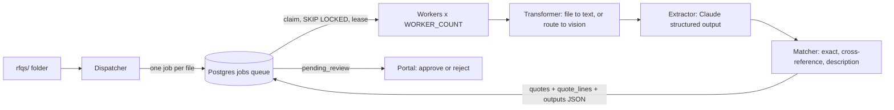
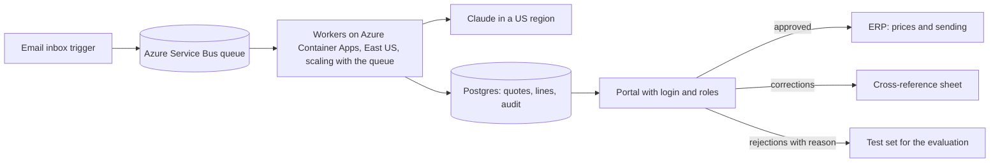

# Ridgeline Quote Desk

Ridgeline Quote Desk turns incoming requests for quotation (RFQs: email, PDF, Excel, photos) into
draft quotes that a person reviews and approves. A dispatcher queues each file in PostgreSQL. Workers
read it with Claude and match every line to the Ridgeline catalog. A Streamlit portal is where
reviewers approve or reject each draft. Nothing is sent to a customer automatically, and the model never
sets prices.

## Repository

https://github.com/Ortiz-100323/ridgeline-quote-desk

| Path | What |
|---|---|
| `app/dispatcher/` | Scans `rfqs/` and queues one job per file |
| `app/worker/` | The worker: `transformer.py` (file to text), `extractor.py` (Claude, structured output), `matcher.py` (line to part number), `worker.py` (queue loop) |
| `app/portal/` | Streamlit review portal and its transactional Postgres operations |
| `app/catalog.py`, `app/seed.py` | Catalog loading and `python -m app.seed` (schema + CSV load) |
| `app/paths.py` | Paths, and `safe_path()`, which refuses `answer_key/` |
| `app/pipeline_log.py` | End-to-end log (`pipeline_logs` table + console) |
| `db/schema.sql` | Authoritative PostgreSQL schema |
| `docs/CONTRACT.md` | Contract between the components: tables, queue SQL, output JSON, flags, known bugs |
| `data/` | Products, customers, cross-reference CSVs (see `data/README.md`) |
| `evaluation/` | `evaluate.py`, `results.json` and the report `evaluation/README.md` |
| `outputs/` | One draft quote per RFQ, `outputs/<rfq_id>.json` |
| `tests/` | Matcher unit tests (`python -m unittest discover -s tests -t .`) |

## How to Run

Quick start, once the setup below is done:

```powershell
.venv\Scripts\Activate.ps1
python -m app.seed                # create the schema and load data/*.csv (idempotent)
python -m app.dispatcher          # queue one job per file in rfqs/
python -m app.worker --once       # WORKER_COUNT processes drain the queue, then stop (omit --once to keep polling)
python -m evaluation.evaluate     # score outputs/ against answer_key/
streamlit run app/portal/streamlit_app.py
```

### 1. Prerequisites

- **Python 3.13** (3.11+ should work) and Git.
- **PostgreSQL 16** (13+ works). The schema uses `gen_random_uuid()` and the `pg_trgm` extension. The
  simplest local option is Docker.
- An **Anthropic API key** for the workers. The portal does not need one.

### 2. Clone and install

```powershell
git clone https://github.com/Ortiz-100323/ridgeline-quote-desk.git
cd ridgeline-quote-desk
python -m venv .venv
.venv\Scripts\Activate.ps1        # macOS/Linux: source .venv/bin/activate
pip install -r requirements.txt
```

### 3. Start PostgreSQL

```powershell
docker run -d --name ridgeline-db `
  -e POSTGRES_DB=ridgeline -e POSTGRES_USER=ridgeline -e POSTGRES_PASSWORD=change-me `
  -p 127.0.0.1:5432:5432 -v ridgeline-pgdata:/var/lib/postgresql/data postgres:16
```

Any other PostgreSQL works too, as long as the user can create tables and the `pg_trgm` extension (or
the extension already exists).

### 4. Configure `.env`

```powershell
Copy-Item .env.example .env       # then fill it in; .env is git-ignored, never commit it
```

Settings come from environment variables. In development they are loaded from `.env`, and every name is
listed in `.env.example`:

| Group | Variables |
|---|---|
| Database | `DATABASE_HOST`, `DATABASE_PORT`, `DATABASE_NAME`, `DATABASE_USER`, `DATABASE_PASSWORD` |
| LLM (required) | `ANTHROPIC_API_KEY`, `MODEL_NAME`, `FALLBACK_MODEL` |
| LLM (optional) | `LLM_TIMEOUT_SECONDS` (120), `LLM_MAX_RETRIES` (3), `LLM_RETRY_BACKOFF_SECONDS` (2), `LLM_RETRY_MAX_BACKOFF_SECONDS` (30), `LLM_CONFIDENCE_THRESHOLD` (0.8), `LLM_MAX_TOKENS` (16000), `LLM_EFFORT` |
| Worker (optional) | `WORKER_COUNT` (1), `WORKER_POLL_SECONDS` (5), `WORKER_LEASE_SECONDS` (600), `WORKER_RETRY_BACKOFF_SECONDS` (60) |
| Matching (optional) | `MATCH_REVIEW_THRESHOLD` (0.8), `TRANSFORMER_MIN_CHARS_PER_PAGE` (50) |

`localhost` is pinned to `127.0.0.1` by `app/db.py`. Standard libpq variables such as
`PGSSLMODE=require` are also honored, which managed databases need.

### 5. Create the schema and load the catalog

```powershell
python -m app.seed
```

This applies `db/schema.sql` and upserts customers, products and cross-references. It is safe to run
again: products edited in the portal keep their edits. Run it after every schema change.

### 6. Queue the RFQs

```powershell
python -m app.dispatcher                  # one pending job per file in rfqs/
python -m app.dispatcher --folder D:\in   # or scan another folder
```

Each run queues every file again with a new job ID (TODO(dedupe) in `docs/CONTRACT.md`), so run it once
per batch.

### 7. Run the workers

```powershell
python -m app.worker --once               # drain the queue, then stop
python -m app.worker                      # keep polling for new jobs (Ctrl+C to stop)
python -m app.worker --workers 3 --once   # override WORKER_COUNT
python -m app.worker --max-jobs 1 --once  # one job per worker, handy for debugging
```

Several worker processes, or several machines, can run at once. Drafts go to the `quotes` and
`quote_lines` tables and to `outputs/<rfq_id>.json`. Ctrl+C puts the current job back in the queue
without using up an attempt.

Single steps can be tried without the database: `python -m app.worker.transformer`,
`python -m app.worker.extractor rfqs/<file> --json` (calls the API) and
`python -m app.worker.matcher "20 ea 6204-2RS bearings"`.

### 8. Open the portal

```powershell
streamlit run app/portal/streamlit_app.py
```

Open http://localhost:8501. The portal only needs the `DATABASE_*` variables.

- **Dashboard:** queue and review metrics, plus recent activity.
- **Processing queue:** worker activity, scheduled retries, attempts and per-job history. Refreshes every
  five seconds while open.
- **Job logs:** look up a job ID to see its pipeline steps and audit events in order.
- **Review queue:** draft lines, prices from the product catalog, confidence, flags and audit history.
- **New matches:** search catalog candidates and save a corrected part number without overwriting the
  worker's original match.
- **Product catalog:** create products or edit their catalog details from the sidebar, or directly during
  review. A product created from a draft line is also selected for that line.
- **Decisions:** approve or reject completed drafts, requeue failed work, and cancel jobs that have not
  started.

Every write checks the job's current state first and creates a `job_events` audit record. The portal
talks only to Postgres. After a code change, restart Streamlit: a running process keeps the old imports.

### 9. Tests, evaluation and the submission check

```powershell
python -m unittest discover -s tests -t .   # DB tests are skipped when Postgres is down
python -m evaluation.evaluate               # writes evaluation/results.json and evaluation/README.md
python check_submission.py                  # repository structure check
```

### 10. Troubleshooting

| Symptom | Fix |
|---|---|
| `KeyError: 'DATABASE_HOST'` | `.env` is missing, or it is not in the repository root. |
| Connection times out | Check that the database is running (`docker ps`) and that `DATABASE_PORT` matches. |
| `extension "pg_trgm" is not available` | Install `postgresql-contrib`, or allow-list it on Azure (see Production). |
| Worker stops with a settings error | Set `ANTHROPIC_API_KEY` and `MODEL_NAME`. |
| A job stays `running` | Its worker died. The job goes back to the queue after `WORKER_LEASE_SECONDS`, or requeue it from the portal. |
| The portal is empty | Run the seed, the dispatcher and a worker first. The portal only shows what is in the database. |

## Approach



1. **Dispatch.** Each file in `rfqs/` becomes a `jobs` row with its path, type and content hash.
2. **Queue.** Workers claim jobs with `FOR UPDATE SKIP LOCKED` and a lease, so no job is taken twice. A
   heartbeat thread renews the lease, and a crashed worker's job is reclaimed when its lease expires.
3. **Transform.** PDFs with a text layer and Excel files become text. Photos, and PDFs with fewer than
   50 characters per page (scans), are sent to Claude as the original file.
4. **Extract.** Claude returns a fixed schema for each line: the customer's text, quantity, unit, the
   part number as written and its kind, a description, issues, and a reading confidence. Timeouts are
   retried with backoff. A low-confidence or unusable answer is sent again to `FALLBACK_MODEL`.
5. **Match.** An exact Ridgeline number scores 0.99. A cross-reference with one target scores 0.95,
   lowered for notes, unverified rows or several targets. A description match scores at most 0.90. A
   discontinued part is replaced by its successor.
6. **Review.** A line goes to a person when its confidence is under 0.8, it carries a blocking flag, or
   it was read from a photo. Flag, don't guess.

Failures never pass silently. An unreadable or unsupported file goes straight to a person with the
reason. A retryable error is retried with backoff up to `max_attempts`, then escalated.

### What we learned building it

- **Tables need their columns.** Plain `pdfplumber` text merges table columns with spaces. The
  transformer cuts each page into bands around the tables and writes table rows as `a | b | c`, so
  reading order and columns both survive. Excel rows keep their row number (`R7: ...`) for tracing.
- **Reading confidence is not request clarity.** A vague line ("same as last order", "a few boxes") is a
  property of the RFQ, not a reading error. If it lowered the confidence, the fallback model would run on
  almost every RFQ and still couldn't fix it. So the LLM reports such lines as `issues`, which become
  review flags, and `extraction_confidence` only measures how well the line could be read.
- **`as_written` needs an exact rule.** The first prompt gave the whole table row for the PDF but only
  the description for the Excel file, and rewrote the email chain's text. The rule now says: in a table,
  part number + description; in an email chain, the original text, with the final quantity and
  description in their own fields and the change explained in `customer_note`.
- **Own the retries.** The SDK's built-in retries are off, so `LLM_MAX_RETRIES` is the only retry
  setting in play. When the retries run out, the error is retryable at the job level, so the queue tries
  again later. If the fallback model fails, a usable primary answer is kept instead of failing the job.
- **Structured output removes format errors, not every failure.** `messages.parse()` with a Pydantic
  schema guarantees the shape, but a refusal or an answer cut off at `max_tokens` still has to be handled.
  Both trigger the fallback model.
- **Photos read well, but ambiguity hides.** The handwritten note was read correctly, but "#40 chain
  10ft x 2 bx" (two boxes, or two 10 ft lengths?) was not flagged by the LLM. The matcher's size check
  caught it. Every photo line goes to review anyway.
- **LLM fields vary between runs.** The customer for `rfq_05` was found in one run and not in the next.
  Customer matching is fuzzy (WRatio ≥ 88) and falls back to the extracted name with `customer_id = null`.
- **Windows needs importable entry points.** `ProcessPoolExecutor` starts processes with spawn, so the
  worker function must live in a module (`app/worker/worker.py`), not in `__main__`.
- **`localhost` can hang.** With Docker Postgres, `localhost` tried `::1` first and hung for about 10
  seconds. `app/db.py` forces `127.0.0.1`.
- **More workers scale almost linearly.** Six RFQs took about 50 s with one worker and about 18 s with
  three, and each job was claimed exactly once.
- **Testing mode duplicates work.** Each dispatcher run queues every file again, so two runs produced 12
  jobs and two drafts per RFQ. Before production the queue must key on `source_sha256`
  (TODO(dedupe) in `docs/CONTRACT.md`).
- **Open bugs from code review** (`docs/CONTRACT.md` §8.1): `outputs/<rfq_id>.json` is shared by
  duplicate jobs, so the last one wins (BUG-1); the JSON file is written before the database commit, so
  a rollback can leave a file with no quote (BUG-2); an unreadable image (`.heic`, corrupt file) fails
  as an unexpected error and is retried 3 times instead of being escalated at once (BUG-3).

## Evaluation

`python -m evaluation.evaluate` compares `outputs/*.json` with `answer_key/` (rfq_01 to rfq_03, 19
lines) and writes [evaluation/results.json](evaluation/results.json) and the full line-by-line report,
[evaluation/README.md](evaluation/README.md). It is the only code that reads the answer key. Predicted
lines are paired with expected lines by text similarity, so a renumbered line still counts.

| Metric | Value |
|---|---|
| **Extraction accuracy** (line found, right quantity and unit) | **89.5%** (17/19) |
| Line recall / precision | 100% / 100% |
| Quantity accuracy | 100% |
| Unit accuracy | 89.5% |
| Match precision @ 0.8 (auto-accepted lines that are right) | 100% (13/13) |
| Match recall @ 0.8 (lines right and auto-accepted) | 76.5% (13/17) |
| Top-1 part accuracy (reviewed or not) | 100% (17/17) |

What the numbers say:

- **No wrong part gets through unreviewed.** Every one of the 13 auto-accepted lines is right. That is
  the target of "flag, don't guess".
- **Both extraction misses are about the unit field, not reading.** On two `rfq_01` lines the customer
  wrote no unit ("10 A42 v-belts", "RL159429 x 3"). The key expects the catalog unit (`EA`, `BX`), but
  the output keeps the customer's unit and leaves it empty. Next fix: when the customer gives no unit,
  use the matched product's unit.
- **Recall is limited by flags, not by the threshold.** The 4 right parts that were not auto-accepted
  carry a blocking flag (no unit given, "same as above but 1/2", a cross-reference note "check
  thickness"). The threshold sweep is flat from 0.5 to 0.9 for that reason; only 0.95 drops recall, to
  47%.
- **Abstaining is the weak spot.** For "same grease cartridges as last order" the key expects no part.
  The matcher proposed one at 0.6 confidence, but sent it to review.
- **Small sample.** 19 lines in 3 RFQs. `rfq_04` to `rfq_06` have no answer key, and the report shows
  their review load instead. Units are normalized before comparing (a `PAIL` counts as `EA`), which is
  slightly lenient.

## Production



- **Trigger:** the dispatcher listens on the quotes inbox instead of a folder.
- **Queue and workers:** Azure Service Bus replaces the Postgres queue. Workers run as containers that
  scale with the queue length. The worker code stays the same: claim, transform, extract, match, write.
- **Data residency:** Claude runs in a US region. Prices and stock come from Ridgeline's ERP, never
  from the model.
- **Portal:** login and roles. Approved quotes go to the ERP, where a person sends them.
- **Learning loop:** part corrections feed the cross-reference sheet. Rejections, with their reason, grow
  the evaluation set, so precision and recall are measured on real traffic.
- **Before go-live:** dedupe on the content hash, fix BUG-1 to BUG-3, fill an empty unit from the
  catalog, track the cost and latency of each LLM call (already in `pipeline_logs`), and alert on
  escalated jobs.

### Deploying the portal

The portal is the simplest part to deploy. It keeps no state, talks only to PostgreSQL, and needs only
the `DATABASE_*` variables (no API key, no RFQ files). The steps below follow the plan: Azure, East US.

**1. Add a `Dockerfile`** at the repository root:

```dockerfile
FROM python:3.13-slim
WORKDIR /app
ENV PYTHONUNBUFFERED=1 PYTHONPATH=/app
COPY requirements.txt .
RUN pip install --no-cache-dir -r requirements.txt
COPY app/ app/
COPY db/ db/
COPY data/ data/
EXPOSE 8501
CMD ["streamlit", "run", "app/portal/streamlit_app.py", \
     "--server.address=0.0.0.0", "--server.port=8501", "--server.headless=true", \
     "--browser.gatherUsageStats=false"]
```

Add a `.dockerignore` with `.env`, `.venv/`, `.git/`, `answer_key/`, `work/` and `outputs/`, so secrets
and the answer key never end up in the image.

**2. Test the image locally** against the local database:

```powershell
docker build -t ridgeline-portal .
docker run --rm -p 8501:8501 --env-file .env -e DATABASE_HOST=host.docker.internal ridgeline-portal
```

**3. Create the database** (Azure Database for PostgreSQL, Flexible Server, East US). Allow-list
`pg_trgm`, then seed once from a machine that can reach the server:

```bash
az group create -n ridgeline-rg -l eastus
az postgres flexible-server create -g ridgeline-rg -n ridgeline-pg -l eastus \
  --version 16 --tier Burstable --sku-name Standard_B1ms \
  --admin-user ridgeline --admin-password '<strong-password>' --database-name ridgeline
az postgres flexible-server parameter set -g ridgeline-rg -s ridgeline-pg \
  --name azure.extensions --value PG_TRGM
# Point .env at ridgeline-pg.postgres.database.azure.com, add PGSSLMODE=require, then:
python -m app.seed
```

**4. Build the image and create the Container App:**

```bash
az acr create -g ridgeline-rg -n ridgelineacr --sku Basic
az acr build -r ridgelineacr -t ridgeline-portal:1 .

az containerapp env create -g ridgeline-rg -n ridgeline-env -l eastus
az containerapp create -g ridgeline-rg -n ridgeline-portal --environment ridgeline-env \
  --image ridgelineacr.azurecr.io/ridgeline-portal:1 --registry-server ridgelineacr.azurecr.io \
  --ingress external --target-port 8501 --min-replicas 1 --max-replicas 3 \
  --secrets db-password='<strong-password>' \
  --env-vars DATABASE_HOST=ridgeline-pg.postgres.database.azure.com DATABASE_PORT=5432 \
             DATABASE_NAME=ridgeline DATABASE_USER=ridgeline DATABASE_PASSWORD=secretref:db-password \
             PGSSLMODE=require
```

**5. Lock it down before sharing the URL:**

- **Login.** The portal has no authentication of its own, so never expose it without one. Turn on
  Container Apps authentication with Microsoft Entra ID and require sign-in, so only reviewers can open
  it. Roles are still on the go-live list.
- **Sticky sessions.** Each Streamlit session lives on one WebSocket. With more than one replica, run
  `az containerapp ingress sticky-sessions set -g ridgeline-rg -n ridgeline-portal --affinity sticky`.
- **Network.** Let the Container Apps environment through the PostgreSQL firewall, or better, put both
  in one VNet with private access.
- **Secrets.** Keep the database password in Container Apps secrets or Key Vault, never in the image.

**6. Release updates** by building a new tag and pointing the app at it. Run `python -m app.seed` first
when `db/schema.sql` changed (it is idempotent):

```bash
az acr build -r ridgelineacr -t ridgeline-portal:2 .
az containerapp update -g ridgeline-rg -n ridgeline-portal --image ridgelineacr.azurecr.io/ridgeline-portal:2
```

Any other container host or VM works the same way: run the same `streamlit run ...
--server.address=0.0.0.0` command with the `DATABASE_*` variables, behind HTTPS and a login.

**Workers and dispatcher** can use the same image with `CMD ["python", "-m", "app.worker"]` plus the
`ANTHROPIC_API_KEY`, `MODEL_NAME`, `FALLBACK_MODEL` and `WORKER_*` settings, and an Azure Files share
mounted for `rfqs/` and `outputs/`. Scale them by adding replicas: `SKIP LOCKED` and leases make that safe
until Service Bus replaces the Postgres queue.
