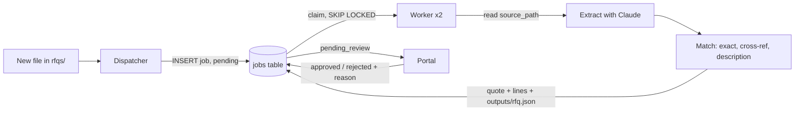
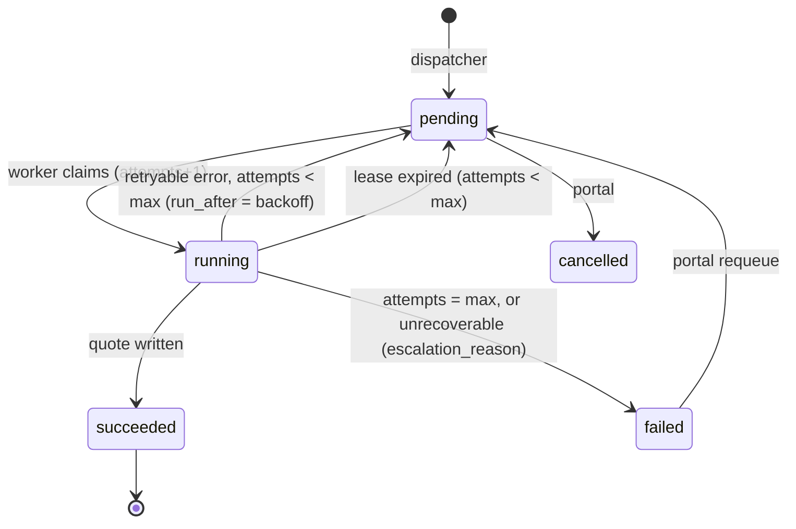

# Ridgeline Quote Desk: system contract

The shared agreement between the **dispatcher**, the **workers** and the **portal**. Any component (written by Claude Code, Codex or a person) must follow it. When this document and the code disagree, `db/schema.sql` is the source of truth for tables. Update both together.

## 1. Ground rules

1. **Never read `answer_key/`.** Only the evaluation script may read it. In Python, open files through `app.paths.safe_path()`, which refuses that folder.
2. **Credentials come from environment variables** (`DATABASE_*`, `ANTHROPIC_API_KEY`, `MODEL_NAME`, `FALLBACK_MODEL`). In dev they are loaded from `.env` by code (`app/db.py`). Never print, log or commit their values. `.env.example` lists the names.
3. **A person approves every quote.** Nothing is sent to a customer automatically.
4. **The model never sets prices.** Prices come from `products.list_price` (Ridgeline's systems), never from the LLM.
5. **Flag, don't guess.** A line below 0.8 confidence, or read from an image, gets `needs_review = true`.

## 2. Flow



## 3. Tables

Postgres 16, created by `db/schema.sql`. Run `python -m app.seed` to create the schema and load `data/*.csv`. The script is idempotent.

| Table | Written by | Purpose |
|---|---|---|
| `customers` | seed | Ridgeline customers |
| `products` | seed | Catalog, with prices and replacements |
| `cross_references` | seed, portal (future) | Competitor part → Ridgeline part |
| `jobs` | dispatcher, worker, portal | **The queue.** One row per RFQ file |
| `job_events` | dispatcher, worker, portal | Audit trail of every status change |
| `pipeline_logs` | every component | End-to-end operational log (§3.4) |
| `quotes` | worker | Draft quote header, plus the exact output JSON |
| `quote_lines` | worker, portal (`corrected_part_number`) | One row per line item |

### 3.1 `jobs`: the queue

| Column | Type | Meaning |
|---|---|---|
| `job_id` | uuid PK | Generated |
| `rfq_id` | text | File stem, e.g. `rfq_01_email`. Becomes `outputs/<rfq_id>.json` |
| `source_path` | text | **Where the worker reads the file.** A POSIX path relative to the repo root, e.g. `rfqs/rfq_02_clearwater.pdf`. Resolve with `app.paths.ROOT / source_path`, through `safe_path()` |
| `file_name` | text | e.g. `rfq_02_clearwater.pdf` |
| `file_type` | text | **Document type**: `text`, `pdf`, `xlsx`, `image` or `other`, from the extension. Picks the extractor |
| `file_extension` | text | Lowercase extension, e.g. `.pdf` |
| `mime_type` | text | e.g. `application/pdf` |
| `file_size_bytes` | bigint | Size when it was queued |
| `source_sha256` | text, indexed | Hash of the file. **Not unique while testing**: every dispatcher run queues every file again (see §8, TODO(dedupe)) |
| `dispatch_run_id` | uuid | The dispatcher run that queued the job. Same value as `pipeline_logs.run_id` |
| `job_status` | text | `pending`, `running`, `succeeded`, `failed` or `cancelled` |
| `review_status` | text | `not_ready`, `pending_review`, `approved` or `rejected` |
| `priority` | smallint | Higher is claimed first (default 0) |
| `attempts` / `max_attempts` | smallint | Claims so far, and the limit (default 3) |
| `run_after` | timestamptz | Not claimable before this time (retry backoff) |
| `locked_by` | text | Worker id, e.g. `worker:1` |
| `locked_at` / `lease_expires_at` | timestamptz | The lease. Once it expires, a crashed worker's job is reclaimed |
| `output_path` | text | e.g. `outputs/rfq_01_email.json` |
| `model_used` / `fallback_used` | text / bool | The model that produced the result, and whether the fallback (Opus) was needed |
| `last_error` | text | Technical error of the last attempt |
| `escalation_reason` | text | Why the whole request went to a person |
| `reviewed_by` / `reviewed_at` | text / timestamptz | Set by the portal |
| `rejection_reason` | text | Required when the quote is rejected |
| `created_at` / `updated_at` | timestamptz | `updated_at` is set by a trigger |
| `started_at` / `finished_at` | timestamptz | First claim, and the move to a final status |

The database enforces these rules (CHECK constraints):

- `running` requires `locked_by` and `lease_expires_at`.
- `succeeded`, `failed` and `cancelled` require `finished_at`.
- `review_status` stays `not_ready` until the job is `succeeded` or `failed`.
- `approved` requires a `succeeded` job. `approved` and `rejected` require `reviewed_by` and `reviewed_at`.
- `rejected` requires a non-empty `rejection_reason`.
- `attempts <= max_attempts`.

### 3.2 Job lifecycle



| `job_status` | `review_status` | Meaning for the portal |
|---|---|---|
| `pending` / `running` | `not_ready` | In progress. Show it, but no actions |
| `succeeded` | `pending_review` | **Draft quote ready.** Approve or reject |
| `failed` | `pending_review` | **The pipeline gave up.** Show `escalation_reason`. Requeue, or reject |
| `succeeded` | `approved` / `rejected` | Done |

### 3.3 Queue operations (SQL)

**Dispatcher: enqueue** (`python -m app.dispatcher [--folder rfqs]`, code in `app/dispatcher/dispatcher.py`). Each run scans the folder (files directly inside it, sorted by name, hidden files skipped). It queues **every** file with a new `job_id`, even if the same file was queued before (testing mode, §8). Each file gets its own transaction, so one bad file doesn't stop the others:
```sql
INSERT INTO jobs (rfq_id, source_path, file_name, file_type, file_extension,
                  mime_type, file_size_bytes, source_sha256, dispatch_run_id)
VALUES (%s, %s, %s, %s, %s, %s, %s, %s, %s)
RETURNING job_id;
INSERT INTO job_events (job_id, event, actor, detail) VALUES (%s, 'created', 'dispatcher', %s);
```

| Extension | `file_type` |
|---|---|
| `.txt` `.eml` `.md` `.msg` | `text` |
| `.pdf` | `pdf` |
| `.xlsx` `.xlsm` `.xls` | `xlsx` |
| `.png` `.jpg` `.jpeg` `.gif` `.webp` `.tif` `.tiff` `.bmp` `.heic` | `image` |
| anything else | `other` (queued, with a `WARNING` log `unknown_file_type`) |

**Worker: claim one job** (safe with any number of workers). Read the file from `source_path`:
```sql
WITH next AS (
    SELECT job_id FROM jobs
    WHERE job_status = 'pending' AND run_after <= now()
    ORDER BY priority DESC, created_at
    FOR UPDATE SKIP LOCKED
    LIMIT 1
)
UPDATE jobs j SET job_status = 'running', attempts = attempts + 1,
       locked_by = %(worker)s, locked_at = now(),
       lease_expires_at = now() + interval '10 minutes',
       started_at = coalesce(started_at, now())
FROM next WHERE j.job_id = next.job_id
RETURNING j.*;
```

**Worker: heartbeat** during long work: `UPDATE jobs SET lease_expires_at = now() + interval '10 minutes' WHERE job_id = %s AND locked_by = %s;`

**Worker: success.** Do all of this in one transaction: insert `quotes` and `quote_lines`, write `outputs/<rfq_id>.json`, then:
```sql
UPDATE jobs SET job_status = 'succeeded', review_status = 'pending_review', finished_at = now(),
       output_path = %s, model_used = %s, fallback_used = %s,
       locked_by = NULL, locked_at = NULL, lease_expires_at = NULL
WHERE job_id = %s AND locked_by = %s;
```

**Worker: retryable failure** (API down, invalid format after the fallback):
- If `attempts < max_attempts`: set `job_status = 'pending'`, `run_after = now() + backoff`, `last_error`, and clear the lock (event `retry_scheduled`).
- Otherwise: set `job_status = 'failed'`, `review_status = 'pending_review'`, `finished_at = now()` and `escalation_reason`, and clear the lock (event `escalated`).

Inside a single attempt, the worker first retries the API call after a few seconds, then retries with `FALLBACK_MODEL` when the answer has the wrong format. A line that is unclear is **never** retried. It is flagged for review.

**Lease recovery** (run by any worker before claiming): jobs that are `running` with `lease_expires_at < now()` go back to `pending` if `attempts < max_attempts`, or to `failed` + `pending_review` otherwise (event `lease_expired`).

### 3.4 `pipeline_logs`: end-to-end log

`job_events` keeps status changes only. `pipeline_logs` keeps **every step** of every component, so one RFQ can be traced from dispatch to review. Write to it with `app.pipeline_log.PipelineLogger`. It uses its own autocommit connection, so rows survive a rolled-back transaction, and it falls back to the console if the DB is down.

| Column | Meaning |
|---|---|
| `log_id` | Identity. Order by it |
| `created_at` | timestamptz |
| `run_id` | One process run: a dispatcher run, a worker session or a portal request |
| `job_id` | The RFQ concerned, or null for run-level steps |
| `component` | `dispatcher`, `worker`, `portal`, `seed` or `evaluation` |
| `actor` | `dispatcher`, `worker:<id>`, `portal:<user>` |
| `level` | `DEBUG`, `INFO`, `WARNING` or `ERROR` |
| `step` | Machine-readable step name (below) |
| `message` | Human-readable sentence |
| `duration_ms` | Optional timing |
| `detail` | jsonb, with step-specific fields |

Steps so far: **dispatcher** `run_started`, `files_found`, `job_created`, `unknown_file_type`, `job_failed`, `run_failed`, `run_finished`. The worker and the portal will add theirs, for example `claimed`, `extracted`, `matched`, `quote_written`, `retry_scheduled`, `escalated`, `approved` and `rejected`. Never put secrets or full RFQ contents in `message` or `detail`.

```sql
-- Everything that happened to one RFQ
SELECT created_at, component, level, step, message FROM pipeline_logs WHERE job_id = %s ORDER BY log_id;
-- One dispatcher run, and the jobs it created
SELECT * FROM pipeline_logs WHERE run_id = %s ORDER BY log_id;
SELECT * FROM jobs WHERE dispatch_run_id = %s;
-- Recent problems
SELECT * FROM pipeline_logs WHERE level IN ('WARNING', 'ERROR') ORDER BY log_id DESC LIMIT 50;
```

## 4. Draft quote JSON (`outputs/<rfq_id>.json`)

The structure follows the answer key and `check_submission.py`. The worker writes the file, and stores the same object in `quotes.output_json`, with one row per line in `quote_lines`.

```json
{
  "rfq_id": "rfq_01_email",
  "customer_id": "C1001",
  "customer_name": "Halvorsen Packaging",
  "lines": [
    {
      "line": 1,
      "as_written": "6204 2RS bearings",
      "quantity": 10,
      "unit": "EA",
      "ridgeline_part_number": "RL000000",
      "match_method": "description",
      "confidence": 0.9,
      "needs_review": false,
      "flags": [],
      "note": "optional free text"
    }
  ],
  "non_item_rows": ["Freight", "Subtotal"]
}
```
(Illustrative values only.)

| Field | Type | Rule |
|---|---|---|
| `rfq_id` | string | Required. Must equal the file name stem |
| `customer_id` | string \| null | Required. A `customers.customer_id`, or null if unknown |
| `customer_name` | string \| null | Optional |
| `non_item_rows` | string[] | Optional. Rows in the RFQ that are not items (freight, totals, notes) |
| `lines` | array | Required and non-empty |
| `lines[].line` | int | 1, 2, 3… with no gaps |
| `lines[].as_written` | string | Non-empty. The customer's text, unchanged |
| `lines[].quantity` | number \| null | |
| `lines[].unit` | string \| null | |
| `lines[].ridgeline_part_number` | string \| null | Never `expected_part_number` (that name is reserved for the answer key) |
| `lines[].match_method` | string \| null | `ridgeline_part_number`, `cross_reference`, `description` or `llm` |
| `lines[].confidence` | number \| null | Between 0 and 1 |
| `lines[].needs_review` | bool | True when confidence < 0.8, when the line was read from an image, or when it carries a blocking flag |
| `lines[].flags` | string[] | See below |
| `lines[].note` | string \| null | Optional. Required on a stub |

**Confidence by method** (from the plan): exact Ridgeline number 0.99, cross-reference with one known match 0.95, description match at most 0.90 (lower when the size doesn't match or two products are too close).

**Stub:** only `rfq_04_handwritten` (the photo) may be a stub. It has a single line with flag `"stub"`, `needs_review: true` and the reason in `note`.

**Flags vocabulary** (proposed; extend it here before using a new flag):

| Flag | When |
|---|---|
| `stub` | Placeholder for an RFQ that was not extracted (photo only) |
| `from_image` | Line read from a photo or a scanned PDF |
| `no_match` | No candidate found |
| `ambiguous_match` | Two or more candidates are too close |
| `ambiguous_cross_reference` | The competitor part maps to more than one Ridgeline part |
| `cross_reference_note` | The cross-reference row has a note ("close sub", "pkg qty differs", "check thickness") |
| `unverified_cross_reference` | The cross-reference row has no `last_verified` |
| `discontinued_replaced` | The requested part is discontinued, and its replacement was quoted |
| `unit_mismatch` | The requested unit differs from the catalog unit |
| `quantity_unclear` | The quantity is missing or ambiguous |

## 5. Cross-reference mapping (for the matcher)

`data/cross_reference.csv` → table `cross_references`:

| CSV column | DB column | Notes |
|---|---|---|
| `competitor` | `competitor` | Apex Industrial (18), MRO Direct (12), Northfield Supply (22) |
| `competitor_part_number` | `competitor_part_number` | As written in the sheet |
| — | `competitor_part_number_norm` | Generated: `normalize_part_number()` (uppercase, no whitespace, `.`, `/` or `-`). **Match on this column** |
| `ridgeline_part_number` | `ridgeline_part_number` | FK to `products`. All 52 exist |
| `notes` | `notes` | `close sub` ×7, `pkg qty differs` ×8, `check thickness` ×1, `dup? Maria to confirm` ×1 |
| `last_verified` | `last_verified` | Date. Empty on 9 rows |
| — | `source` | `seed` (from the CSV) or `portal_correction` (future: fixes from reviewers) |

The key is `(competitor_part_number_norm, ridgeline_part_number)`, **not** the competitor number alone: `NF-610338` maps to two parts (`RL177128`, `RL107716`).

**Matcher lookup order:**

1. **Exact Ridgeline number:** `products.part_number_norm = normalize_part_number(token)` → `ridgeline_part_number`, 0.99.
2. **Cross-reference:** `cross_references.competitor_part_number_norm = normalize_part_number(token)`.
   - One row → `cross_reference`, 0.95. A note, or a missing `last_verified`, lowers the confidence and adds a flag.
   - Several rows → flag `ambiguous_cross_reference` and set `needs_review`.
3. **Description:** trigram similarity on `products.description` (`pg_trgm` index `products_description_trgm`) or `rapidfuzz` over `app.catalog`, then rerank. At most 0.90.
4. **LLM pick** among the description candidates → `llm`.

After any step, if the product is `discontinued`, follow `products.replaced_by` (`RL150432` → `RL120374`), quote the replacement and add the flag `discontinued_replaced`. One cross-reference row points to the discontinued part.

The same data is available in memory through `app.catalog.load_catalog()` (`products_normalized`, `cross_references`, `resolve_replacement()`).

## 6. Portal contract (for Codex)

The portal is a web app that reviewers use. It talks **only to Postgres**, through the `DATABASE_*` env vars. It does not read `rfqs/`, `outputs/` or `answer_key/` directly. The original file can be shown through `jobs.source_path`, if the portal serves it read-only.

**Reads**

```sql
-- Review queue
SELECT job_id, rfq_id, file_name, job_status, review_status, escalation_reason, finished_at,
       (SELECT count(*) FROM quote_lines l WHERE l.job_id = j.job_id AND l.needs_review) AS lines_to_review
FROM jobs j WHERE review_status = 'pending_review' ORDER BY finished_at;

-- All jobs (dashboard): every column of jobs, newest first.

-- One quote
SELECT q.*, c.name AS catalog_customer_name, c.pricing_tier
FROM quotes q LEFT JOIN customers c USING (customer_id) WHERE q.job_id = %s;

SELECT l.*, p.description, p.unit AS catalog_unit, p.list_price, p.status AS product_status
FROM quote_lines l LEFT JOIN products p ON p.part_number = coalesce(l.corrected_part_number, l.ridgeline_part_number)
WHERE l.job_id = %s ORDER BY l.line;

-- History
SELECT * FROM job_events WHERE job_id = %s ORDER BY created_at;
```

**Writes.** Each one is a single transaction that also inserts a `job_events` row with `actor = 'portal:<user>'`. Guard every write with its `WHERE` precondition, and treat 0 rows updated as "someone else already acted".

| Action | SQL | Precondition |
|---|---|---|
| Approve | `SET review_status='approved', reviewed_by=%s, reviewed_at=now()` | `job_status='succeeded' AND review_status='pending_review'` |
| Reject | `SET review_status='rejected', reviewed_by=%s, reviewed_at=now(), rejection_reason=%s` | `review_status='pending_review'`. A reason is required |
| Requeue a failed job | `SET job_status='pending', review_status='not_ready', attempts=0, run_after=now(), finished_at=NULL, escalation_reason=NULL, last_error=NULL` | `job_status='failed' AND review_status='pending_review'` |
| Cancel | `SET job_status='cancelled', finished_at=now()` | `job_status='pending'` |
| Fix a part | `UPDATE quote_lines SET corrected_part_number=%s` | Job is `pending_review`. The part must exist in `products`; record a `part_corrected` event |

**The portal must not:** change prices or write to `products` and `customers`; edit `as_written`, `confidence` or `match_method`; change `running` jobs; delete rows.

## 7. Files

| Path | What |
|---|---|
| `db/schema.sql` | Tables, constraints, indexes |
| `app/db.py` | `connect()`, `apply_schema()` |
| `app/seed.py` | `python -m app.seed`: schema + CSV load |
| `app/catalog.py` | In-memory catalog and `normalize_part_number()` |
| `app/paths.py` | Paths and `safe_path()` |
| `app/pipeline_log.py` | `PipelineLogger`: writes `pipeline_logs` and the console |
| `app/dispatcher/` | Part 1: `python -m app.dispatcher` scans `rfqs/` and queues jobs |
| `app/worker/` | Part 2 |
| `app/portal/` | Streamlit review portal and its Postgres repository |
| `data/` | Reference CSVs (see `data/README.md`) |

## 8. Future work

- **TODO(dedupe): stop queuing the same RFQ twice.** While testing, every dispatcher run queues every file again with a new `job_id`, and nothing is a key: not the file name, not `rfq_id`, not `source_sha256`. Before production:
  1. Key on content, not on the name: `ALTER TABLE jobs ADD CONSTRAINT jobs_source_sha256_key UNIQUE (source_sha256);` (drop the matching `DROP CONSTRAINT` line in `db/schema.sql`), plus `ON CONFLICT (source_sha256) DO NOTHING` in the dispatcher. File names are not reliable, because two customers can send `quote.pdf`.
  2. Decide what an intentional re-run means (for example, a `requeued` event on the existing job instead of a new row).
  3. Clean up the duplicate test jobs before adding the constraint.
- **Folder → inbox trigger.** In production the dispatcher listens on the email inbox instead of a folder (see the plan).
