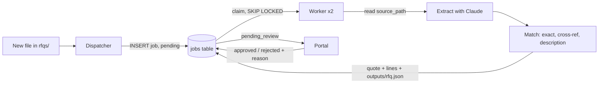
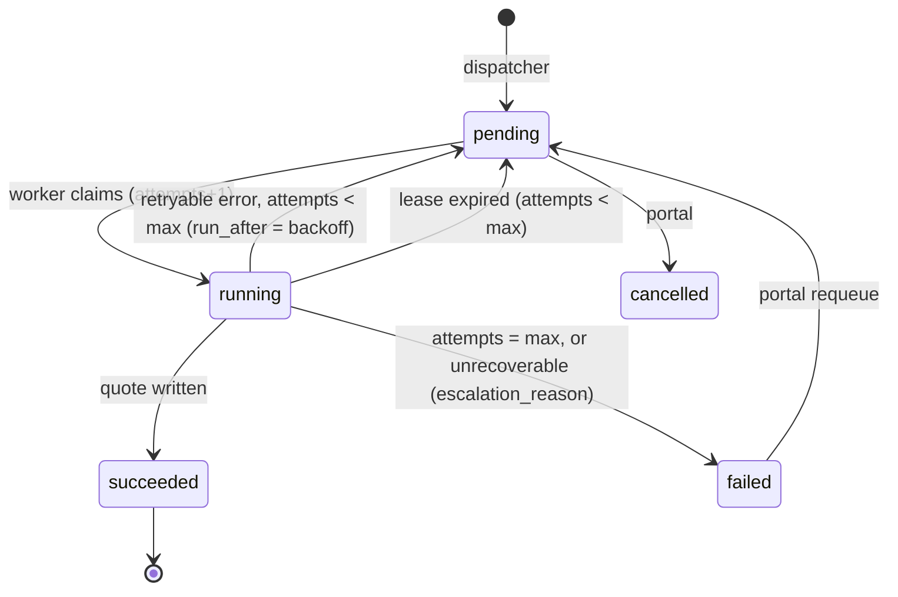
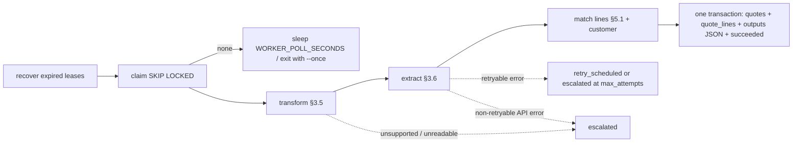

# Ridgeline Quote Desk: system contract

The shared agreement between the **dispatcher**, the **workers** and the **portal**. Any component (written by Claude Code, Codex or a person) must follow it. When this document and the code disagree, `db/schema.sql` is the source of truth for tables. Update both together.

## 1. Ground rules

1. **Never read `answer_key/`.** Only the evaluation script may read it. In Python, open files through `app.paths.safe_path()`, which refuses that folder.
2. **Credentials come from environment variables** (`DATABASE_*`, `ANTHROPIC_API_KEY`, `MODEL_NAME`, `FALLBACK_MODEL`). In dev they are loaded from `.env` by code (`app/db.py`). Never print, log or commit their values. `.env.example` lists the names.
3. **A person approves every quote.** Nothing is sent to a customer automatically.
4. **The model never sets prices.** Prices come from `products.list_price` (Ridgeline's systems), never from the LLM.
5. **Flag, don't guess.** A line below 0.8 confidence, or read from an image, gets `needs_review = true`.

## 2. Flow



## 3. Tables

Postgres 16, created by `db/schema.sql`. Run `python -m app.seed` to create the schema and load `data/*.csv`. The script is idempotent.

| Table | Written by | Purpose |
|---|---|---|
| `customers` | seed | Ridgeline customers |
| `products` | seed, portal | Catalog, with prices and replacements |
| `cross_references` | seed, portal (future) | Competitor part → Ridgeline part |
| `jobs` | dispatcher, worker, portal | **The queue.** One row per RFQ file |
| `job_events` | dispatcher, worker, portal | Audit trail of every status change |
| `pipeline_logs` | every component | End-to-end operational log (§3.4) |
| `quotes` | worker | Draft quote header, plus the exact output JSON |
| `quote_lines` | worker, portal (`corrected_part_number`) | One row per line item |

### 3.1 `jobs`: the queue

| Column | Type | Meaning |
|---|---|---|
| `job_id` | uuid PK | Generated |
| `rfq_id` | text | File stem, e.g. `rfq_01_email`. Becomes `outputs/<rfq_id>.json` |
| `source_path` | text | **Where the worker reads the file.** A POSIX path relative to the repo root, e.g. `rfqs/rfq_02_clearwater.pdf`. Resolve with `app.paths.ROOT / source_path`, through `safe_path()` |
| `file_name` | text | e.g. `rfq_02_clearwater.pdf` |
| `file_type` | text | **Document type**: `text`, `pdf`, `xlsx`, `image` or `other`, from the extension. Picks the extractor |
| `file_extension` | text | Lowercase extension, e.g. `.pdf` |
| `mime_type` | text | e.g. `application/pdf` |
| `file_size_bytes` | bigint | Size when it was queued |
| `source_sha256` | text, indexed | Hash of the file. **Not unique while testing**: every dispatcher run queues every file again (see §8, TODO(dedupe)) |
| `dispatch_run_id` | uuid | The dispatcher run that queued the job. Same value as `pipeline_logs.run_id` |
| `job_status` | text | `pending`, `running`, `succeeded`, `failed` or `cancelled` |
| `review_status` | text | `not_ready`, `pending_review`, `approved` or `rejected` |
| `priority` | smallint | Higher is claimed first (default 0) |
| `attempts` / `max_attempts` | smallint | Claims so far, and the limit (default 3) |
| `run_after` | timestamptz | Not claimable before this time (retry backoff) |
| `locked_by` | text | Worker id, e.g. `worker:1` |
| `locked_at` / `lease_expires_at` | timestamptz | The lease. Once it expires, a crashed worker's job is reclaimed |
| `output_path` | text | e.g. `outputs/rfq_01_email.json` |
| `model_used` / `fallback_used` | text / bool | The model that produced the result, and whether the fallback (Opus) was needed |
| `last_error` | text | Technical error of the last attempt |
| `escalation_reason` | text | Why the whole request went to a person |
| `reviewed_by` / `reviewed_at` | text / timestamptz | Set by the portal |
| `rejection_reason` | text | Required when the quote is rejected |
| `created_at` / `updated_at` | timestamptz | `updated_at` is set by a trigger |
| `started_at` / `finished_at` | timestamptz | First claim, and the move to a final status |

The database enforces these rules (CHECK constraints):

- `running` requires `locked_by` and `lease_expires_at`.
- `succeeded`, `failed` and `cancelled` require `finished_at`.
- `review_status` stays `not_ready` until the job is `succeeded` or `failed`.
- `approved` requires a `succeeded` job. `approved` and `rejected` require `reviewed_by` and `reviewed_at`.
- `rejected` requires a non-empty `rejection_reason`.
- `attempts <= max_attempts`.

### 3.2 Job lifecycle



| `job_status` | `review_status` | Meaning for the portal |
|---|---|---|
| `pending` / `running` | `not_ready` | In progress. Show it, but no actions |
| `succeeded` | `pending_review` | **Draft quote ready.** Approve or reject |
| `failed` | `pending_review` | **The pipeline gave up.** Show `escalation_reason`. Requeue, or reject |
| `succeeded` | `approved` / `rejected` | Done |

### 3.3 Queue operations (SQL)

**Dispatcher: enqueue** (`python -m app.dispatcher [--folder rfqs]`, code in `app/dispatcher/dispatcher.py`). Each run scans the folder (files directly inside it, sorted by name, hidden files skipped). It queues **every** file with a new `job_id`, even if the same file was queued before (testing mode, §8). Each file gets its own transaction, so one bad file doesn't stop the others:
```sql
INSERT INTO jobs (rfq_id, source_path, file_name, file_type, file_extension,
                  mime_type, file_size_bytes, source_sha256, dispatch_run_id)
VALUES (%s, %s, %s, %s, %s, %s, %s, %s, %s)
RETURNING job_id;
INSERT INTO job_events (job_id, event, actor, detail) VALUES (%s, 'created', 'dispatcher', %s);
```

| Extension | `file_type` |
|---|---|
| `.txt` `.eml` `.md` `.msg` | `text` |
| `.pdf` | `pdf` |
| `.xlsx` `.xlsm` `.xls` | `xlsx` |
| `.png` `.jpg` `.jpeg` `.gif` `.webp` `.tif` `.tiff` `.bmp` `.heic` | `image` |
| anything else | `other` (queued, with a `WARNING` log `unknown_file_type`) |

**Worker: claim one job** (safe with any number of workers). Read the file from `source_path`:
```sql
WITH next AS (
    SELECT job_id FROM jobs
    WHERE job_status = 'pending' AND run_after <= now()
    ORDER BY priority DESC, created_at
    FOR UPDATE SKIP LOCKED
    LIMIT 1
)
UPDATE jobs j SET job_status = 'running', attempts = attempts + 1,
       locked_by = %(worker)s, locked_at = now(),
       lease_expires_at = now() + interval '10 minutes',
       started_at = coalesce(started_at, now())
FROM next WHERE j.job_id = next.job_id
RETURNING j.*;
```

**Worker: heartbeat** during long work: `UPDATE jobs SET lease_expires_at = now() + interval '10 minutes' WHERE job_id = %s AND locked_by = %s;`

**Worker: success.** Do all of this in one transaction: insert `quotes` and `quote_lines`, write `outputs/<rfq_id>.json`, then:
```sql
UPDATE jobs SET job_status = 'succeeded', review_status = 'pending_review', finished_at = now(),
       output_path = %s, model_used = %s, fallback_used = %s,
       locked_by = NULL, locked_at = NULL, lease_expires_at = NULL
WHERE job_id = %s AND locked_by = %s;
```

**Worker: retryable failure** (API down, invalid format after the fallback):
- If `attempts < max_attempts`: set `job_status = 'pending'`, `run_after = now() + backoff`, `last_error`, and clear the lock (event `retry_scheduled`).
- Otherwise: set `job_status = 'failed'`, `review_status = 'pending_review'`, `finished_at = now()` and `escalation_reason`, and clear the lock (event `escalated`).

Inside a single attempt, the worker first retries the API call after a few seconds, then retries with `FALLBACK_MODEL` when the answer has the wrong format. A line that is unclear is **never** retried. It is flagged for review.

**Lease recovery** (run by any worker before claiming): jobs that are `running` with `lease_expires_at < now()` go back to `pending` if `attempts < max_attempts`, or to `failed` + `pending_review` otherwise (event `lease_expired`).

### 3.4 `pipeline_logs`: end-to-end log

`job_events` keeps status changes only. `pipeline_logs` keeps **every step** of every component, so one RFQ can be traced from dispatch to review. Write to it with `app.pipeline_log.PipelineLogger`:
- It uses its own autocommit connection, so rows survive a rolled-back transaction.
- After a dropped connection it reconnects once per write, and falls back to the console if the DB stays down.
- It is thread-safe.
- The portal writes its rows directly, in the same transaction as the review action (`_log_portal`).

**Every log row is searchable by job.** A row about one RFQ has `job_id`. A run-level row (`run_started`, `worker_stopped`, ...) has no single job, so it lists the run's jobs in `job_ids`. Call `log.link_run_rows()` before the last row of a run, so the run's earlier rows get them too. The view **`job_log`** puts it all together with one `job_id` per row: `pipeline_logs` (directly or through `job_ids`) plus `job_events`. Rows that have no job at all (a run that queued nothing, a product edit) are not in the view.

**Error text.** Write exceptions to the DB with `safe_error(exc)`: the class name and the first line, and for database errors the primary message, constraint and sqlstate, **never** psycopg's `DETAIL: Failing row contains (...)`, which can hold RFQ text. Full tracebacks go to the console only.

| Column | Meaning |
|---|---|
| `log_id` | Identity. Order by it |
| `created_at` | timestamptz |
| `run_id` | One process run: a dispatcher run, a worker session or a portal request |
| `job_id` | The RFQ concerned, or null for run-level steps |
| `job_ids` | uuid[]. On run-level rows: the jobs the run touched (GIN index) |
| `component` | `dispatcher`, `worker`, `portal`, `seed` or `evaluation` |
| `actor` | `dispatcher`, `worker:<id>`, `portal:<user>` |
| `level` | `DEBUG`, `INFO`, `WARNING` or `ERROR` |
| `step` | Machine-readable step name (below) |
| `message` | Human-readable sentence |
| `duration_ms` | Optional timing |
| `detail` | jsonb, with step-specific fields |

Steps so far: **dispatcher** `run_started`, `files_found`, `job_created`, `unknown_file_type`, `job_failed`, `run_failed`, `run_finished`. **worker transformer** (§3.5) `transformed`, `routed_to_llm`, `unsupported_file`. **worker extractor** (§3.6) `llm_call`, `llm_retry`, `llm_retries_exhausted`, `llm_fallback`, `llm_fallback_failed`, `extracted`, `extraction_failed`. **worker matcher** (§5.1) `matched`. **worker loop** (§3.7) `worker_started`, `lease_expired`, `claimed`, `customer_matched`, `customer_unknown`, `quote_written`, `retry_scheduled`, `escalated`, `lease_lost`, `heartbeat_failed`, `released`, `worker_crashed`, `worker_stopped`. **portal** `approved`, `rejected`, `requeued`, `cancelled`, `part_corrected`, `product_created`, `product_updated`. Never put secrets or full RFQ contents in `message` or `detail`.

```sql
-- Everything that happened to one RFQ, from both tables, run-level rows included
SELECT created_at, source, component, level, step, message FROM job_log WHERE job_id = %s ORDER BY created_at;
-- Run-level rows of the runs that touched a job
SELECT * FROM pipeline_logs WHERE %s = ANY(job_ids) ORDER BY log_id;
-- One dispatcher run, and the jobs it created
SELECT * FROM pipeline_logs WHERE run_id = %s ORDER BY log_id;
SELECT * FROM jobs WHERE dispatch_run_id = %s;
-- Recent problems
SELECT * FROM pipeline_logs WHERE level IN ('WARNING', 'ERROR') ORDER BY log_id DESC LIMIT 50;
```

### 3.5 Worker step 1: transformer (`app/worker/transformer.py`)

`transform(source_path, rfq_id=, job_id=, log=)` turns the job's file into text for the LLM, or routes it to the LLM unchanged. Not wired to the queue yet: the worker flow will call it after `claimed`.

| Input | `route` | Output |
|---|---|---|
| `.txt` `.eml` `.md` | `text` | Passed through: `text_path` is the source file |
| `.pdf` with a text layer | `text` | `work/text/<rfq_id>_<job_id[:8]>.txt`. Pages as `=== Page N ===`; tables as `a \| b \| c` rows, kept in reading order |
| `.xlsx` `.xlsm` | `text` | Same location. Each sheet as `=== Sheet: name ===`, each non-empty row as `R<row>: a \| b \| c` (row numbers kept for traceability) |
| `.pdf` under `TRANSFORMER_MIN_CHARS_PER_PAGE` (default 50) non-whitespace chars per page | `llm_direct` | None. Scanned document: the original goes to the LLM (vision), lines get the `from_image` flag |
| images (`.png`, `.jpg`, ...) | `llm_direct` | None. Same as above |
| `.xls`, `other` | `unsupported` | None. Escalate to a person |

A supported file that cannot be read (corrupt or encrypted) raises `TransformError`: treat it as unrecoverable (`failed` + `escalation_reason`). `work/` is git-ignored scratch space; never put it under `outputs/`, which only holds quote JSONs. Try it without the database: `python -m app.worker.transformer [files...]`.

### 3.6 Worker step 2: LLM extraction (`app/worker/extractor.py`)

`Extractor(log=).extract(transform_result, job_id=)` sends the RFQ to Claude with a structured-output schema (`app/worker/schemas.py`: `RfqExtraction` with `ExtractedLine`) and returns an `ExtractionResult`. It **extracts only**: part numbers are copied as written and classified (`ridgeline`, `competitor`, `manufacturer`), and the matcher maps them to `products` and `customers` later.

- **Input.** Route `text`: the text, inside `<rfq_document>` tags (treated as data, not instructions). Route `llm_direct`: images as image blocks (converted to PNG when the type isn't accepted or the file is over 5 MB) and scanned PDFs as document blocks. `result.from_image` is set, so every line gets `from_image` and `needs_review`.
- **Timeouts.** Timeouts, connection errors, 408, 409, 429 and 5xx are retried `LLM_MAX_RETRIES` times per model, with backoff `LLM_RETRY_BACKOFF_SECONDS * 2^(n-1)` (max `LLM_RETRY_MAX_BACKOFF_SECONDS`) plus jitter. The SDK's own retries are off. When the retries run out: `ExtractionError(retryable=True)`, so the queue schedules a retry (§3.3). Other 4xx errors raise `retryable=False`.
- **Fallback.** Document confidence = min(`overall_confidence`, mean line `extraction_confidence`). Below `LLM_CONFIDENCE_THRESHOLD`, or on an unusable answer (invalid JSON, cut off at `max_tokens`, refusal, no lines), the same request goes once to `FALLBACK_MODEL`. Its answer is used when it is usable. If the fallback fails but the primary answer is usable, the primary answer is kept. `below_threshold` stays true when the final answer is still under the threshold. The result goes to `jobs.model_used` / `fallback_used`.
- **Not a reason to fall back.** A vague request ("same as last order", "a few boxes") is a property of the RFQ, not a reading error. It goes into `ExtractedLine.issues` (`quantity_unclear`, `unit_unclear`, `refers_to_previous_order`, `refers_to_other_line`, `vague_description`, `illegible`, `substitution_allowed`), which the matcher turns into flags and `needs_review`.
- **Email chains.** `as_written` keeps the original text. Quantity and description take the final values, and `customer_note` says what changed.
- **Settings** (env, see `.env.example`): `ANTHROPIC_API_KEY`, `MODEL_NAME`, `FALLBACK_MODEL`, `LLM_TIMEOUT_SECONDS` (120), `LLM_MAX_RETRIES` (3), `LLM_RETRY_BACKOFF_SECONDS` (2), `LLM_RETRY_MAX_BACKOFF_SECONDS` (30), `LLM_CONFIDENCE_THRESHOLD` (0.8), `LLM_MAX_TOKENS` (16000), `LLM_EFFORT` (empty = model default).
- **Logs** never contain RFQ text: model, duration, tokens, stop reason, request id, confidence and line numbers only. CLI (calls the API, no database): `python -m app.worker.extractor rfqs/<file> [--json]`.

### 3.7 Worker flow (`app/worker/worker.py`, `python -m app.worker`)



- **Claim and lease.** The claim SQL is §3.3, with a lease of `WORKER_LEASE_SECONDS` (600). A heartbeat thread renews the lease every lease/3 on its own connection. Every final `UPDATE` is guarded by `locked_by = <this worker>`. If the job was reclaimed meanwhile, the result is discarded (`lease_lost`).
- **Customer.** `customer_name` from the extraction is fuzzy-matched (rapidfuzz WRatio ≥ 88) to `customers.name`. Below that score: `customer_id = null`, the extracted name is kept, and a `customer_unknown` log is written.
- **Lines.** `Matcher(load_catalog_from_db(conn)).match_line(...)` runs for every extracted line. The catalog is reloaded for each job, so portal edits count. Line numbers are renumbered 1..n.
- **Success** (one transaction): delete any old draft for the job (after a portal requeue), insert `quotes` and `quote_lines`, write `outputs/<rfq_id>.json` atomically (temp file + rename), then set `succeeded` + `pending_review`, with `model_used` and `fallback_used`. The `succeeded` event detail has the line count, `lines_needing_review`, `customer_id`, model, fallback, document confidence and tokens.
- **Failure.**

  | Cause | Result |
  |---|---|
  | `ExtractionError(retryable=True)` (timeouts after the in-call retries, no usable answer even from the fallback), or an unexpected exception | `attempts < max_attempts`: `pending`, `run_after = now() + WORKER_RETRY_BACKOFF_SECONDS * 2^(attempts-1)`, event `retry_scheduled`. Otherwise: `failed` + `pending_review` + `escalation_reason`, event `escalated` |
  | Unsupported type, unreadable or missing file, non-retryable API error (400/401...) | At once `failed` + `pending_review` + `escalation_reason`, event `escalated` |
  | Ctrl+C during a job | Job released: back to `pending` without spending the attempt, event `requeued` |

- **Run:** `python -m app.worker [--workers N] [--once] [--max-jobs N] [--worker-id ID]`. It starts `WORKER_COUNT` worker processes (default 1; `--workers` overrides it), named `worker:<id>-1..N`. With one process, the actor is `worker:<id>` (default `<hostname>-<pid>`). `--max-jobs` applies to each worker. Settings: `WORKER_COUNT` (1), `WORKER_POLL_SECONDS` (5), `WORKER_LEASE_SECONDS` (600), `WORKER_RETRY_BACKOFF_SECONDS` (60), plus the `LLM_*` settings (§3.6).

## 4. Draft quote JSON (`outputs/<rfq_id>.json`)

The structure follows the answer key and `check_submission.py`. The worker writes the file, and stores the same object in `quotes.output_json`, with one row per line in `quote_lines`.

```json
{
  "rfq_id": "rfq_01_email",
  "customer_id": "C1001",
  "customer_name": "Halvorsen Packaging",
  "lines": [
    {
      "line": 1,
      "as_written": "6204 2RS bearings",
      "quantity": 10,
      "unit": "EA",
      "ridgeline_part_number": "RL000000",
      "match_method": "description",
      "confidence": 0.9,
      "needs_review": false,
      "flags": [],
      "note": "optional free text"
    }
  ],
  "non_item_rows": ["Freight", "Subtotal"]
}
```
(Illustrative values only.)

| Field | Type | Rule |
|---|---|---|
| `rfq_id` | string | Required. Must equal the file name stem |
| `customer_id` | string \| null | Required. A `customers.customer_id`, or null if unknown |
| `customer_name` | string \| null | Optional |
| `non_item_rows` | string[] | Optional. Rows in the RFQ that are not items (freight, totals, notes) |
| `lines` | array | Required and non-empty |
| `lines[].line` | int | 1, 2, 3… with no gaps |
| `lines[].as_written` | string | Non-empty. The customer's text, unchanged |
| `lines[].quantity` | number \| null | |
| `lines[].unit` | string \| null | |
| `lines[].ridgeline_part_number` | string \| null | Never `expected_part_number` (that name is reserved for the answer key) |
| `lines[].match_method` | string \| null | `ridgeline_part_number`, `cross_reference`, `description` or `llm` |
| `lines[].confidence` | number \| null | Between 0 and 1 |
| `lines[].needs_review` | bool | True when confidence < 0.8, when the line was read from an image, or when it carries a blocking flag |
| `lines[].flags` | string[] | See below |
| `lines[].note` | string \| null | Optional. Required on a stub |

**Confidence by method** (from the plan): exact Ridgeline number 0.99, cross-reference with one known match 0.95, description match at most 0.90 (lower when the size doesn't match or two products are too close).

**Stub:** only `rfq_04_handwritten` (the photo) may be a stub. It has a single line with flag `"stub"`, `needs_review: true` and the reason in `note`.

**Flags vocabulary** (proposed; extend it here before using a new flag):

| Flag | When |
|---|---|
| `stub` | Placeholder for an RFQ that was not extracted (photo only) |
| `from_image` | Line read from a photo or a scanned PDF |
| `no_match` | No candidate found |
| `ambiguous_match` | Two or more candidates are too close |
| `ambiguous_cross_reference` | The competitor part maps to more than one Ridgeline part |
| `cross_reference_note` | The cross-reference row has a note ("close sub", "pkg qty differs", "check thickness") |
| `unverified_cross_reference` | The cross-reference row has no `last_verified` |
| `discontinued_replaced` | The requested part is discontinued, and its replacement was quoted |
| `unit_mismatch` | The requested unit differs from the catalog unit |
| `quantity_unclear` | The quantity is missing or ambiguous |
| `cross_reference_missing` | A competitor number that is not in the cross-reference sheet; matched by description instead |
| `cross_reference_conflict` | The line's description does not fit the cross-referenced part (size missing, or similarity < 0.5) |
| `size_mismatch` | The best description match lacks a size or spec the customer wrote |
| `discontinued` | Matched a discontinued part with no replacement |
| `low_extraction_confidence` | The extractor was unsure it read the line correctly (below the review threshold) |
| `unit_unclear`, `refers_to_previous_order`, `refers_to_other_line`, `vague_description`, `illegible`, `substitution_allowed` | Copied from the extractor's `issues` (§3.6) |

Every flag needs review except `unverified_cross_reference`, `discontinued_replaced`, `cross_reference_missing` and `substitution_allowed`, which are informational (`BLOCKING_FLAGS` in `app/worker/matcher.py`).

## 5. Cross-reference mapping (for the matcher)

`data/cross_reference.csv` → table `cross_references`:

| CSV column | DB column | Notes |
|---|---|---|
| `competitor` | `competitor` | Apex Industrial (18), MRO Direct (12), Northfield Supply (22) |
| `competitor_part_number` | `competitor_part_number` | As written in the sheet |
| — | `competitor_part_number_norm` | Generated: `normalize_part_number()` (uppercase, no whitespace, `.`, `/` or `-`). **Match on this column** |
| `ridgeline_part_number` | `ridgeline_part_number` | FK to `products`. All 52 exist |
| `notes` | `notes` | `close sub` ×7, `pkg qty differs` ×8, `check thickness` ×1, `dup? Maria to confirm` ×1 |
| `last_verified` | `last_verified` | Date. Empty on 9 rows |
| — | `source` | `seed` (from the CSV) or `portal_correction` (future: fixes from reviewers) |

The key is `(competitor_part_number_norm, ridgeline_part_number)`, **not** the competitor number alone: `NF-610338` maps to two parts (`RL177128`, `RL107716`).

### 5.1 Worker step 3: matcher (`app/worker/matcher.py`)

```python
from app.catalog import load_catalog_from_db
from app.worker.matcher import Matcher

matcher = Matcher(load_catalog_from_db(conn))   # worker: DB, so portal corrections count
                                                # (Matcher() alone loads data/*.csv)
result = matcher.match_line(extracted_line, from_image=extraction.from_image, log=log, job_id=job_id)
line_json = {**extracted_fields, **result.to_line_fields()}   # ridgeline_part_number, match_method,
                                                              # confidence, needs_review, flags, note
```

`match(as_written, part_number=, description=, unit=, from_image=)` does the same with plain strings: without a part number or description, it finds them in `as_written` itself. `search(text, k=5, unit=)` returns the top catalog candidates. Every `MatchResult` carries `candidates` (top 5, with score and the tokens they miss) for the future LLM pick. The CLI uses the CSV data and needs no database: `python -m app.worker.matcher "20 ea 6204-2RS bearings" "NF-610338"`. Tests: `python -m unittest discover -s tests -t .`

**Lookup order** (first hit wins):

| Step | How | `match_method` | Confidence |
|---|---|---|---|
| 1. Our part number | Any token of the line, or `part_number`, equals `products.part_number_norm` after `normalize_part_number()` | `ridgeline_part_number` | 0.99 |
| 2. Cross-reference | Same, against `cross_references.competitor_part_number_norm` | `cross_reference` | 0.95. A note caps it at 0.75 (`cross_reference_note`). No `last_verified`: −0.05. Description doesn't fit: capped at 0.60 (`cross_reference_conflict`). Two or more targets: 0.60 (`ambiguous_cross_reference`), with the target that best fits the description first |
| 3. Description | Most similar product (below) | `description` | 0.90 × similarity. Missing size: capped at 0.70 (`size_mismatch`). Top two within 0.05: capped at 0.60 (`ambiguous_match`). Similarity < 0.35, or no word in common: `no_match`, part null |
| 4. LLM pick (future) | The LLM chooses among `candidates` | `llm` | — |

After the match, a `discontinued` product is replaced by its `replaced_by` part (−0.05, `discontinued_replaced`), and a requested unit that differs from the catalog unit adds `unit_mismatch`. Through `match_line`, extraction `issues` become flags, `extraction_confidence` caps the confidence, and `customer_note` is added to the note. `needs_review` = confidence < `MATCH_REVIEW_THRESHOLD` (env, default 0.8) **or** a blocking flag (§4).

**Description similarity.** It works on the tokens of the customer's description and of each catalog description, after the same normalization on both sides:
- Inch marks are dropped (`2"`, `2 in` → `2`), `150#` → `150lb`, `gr5`/`grade 5` → `grade5`, `5 HP` → `5hp`, `AW 46` → `aw46`, `1 1/2` → `1-1/2`, `20 x 20 x 2` → `20x20x2`, `L`/`Large`/`size L` → `size_l`.
- Synonyms: bolt = screw, hyd = hydraulic, SS = stainless, FP = full port. Plurals are dropped.
- Score = the IDF-weighted share of the customer's tokens found in the product: rare tokens like `6205` weigh more than `bearing`.
- **Sizes and specs** (any token with a digit) must match exactly. Words may match with small typos (rapidfuzz ratio ≥ 85).
- Words that aren't in the catalog count little. Unknown sizes count a lot.
- A candidate whose unit equals the requested unit gets +0.06 in the ranking, so "nitrile gloves L, boxes" picks the box of disposable gloves.
- A discontinued product and its replacement count as one candidate.

## 6. Portal contract (for Codex)

The portal is a web app that reviewers use. It talks **only to Postgres**, through the `DATABASE_*` env vars. It does not read `rfqs/`, `outputs/` or `answer_key/` directly. The original file can be shown through `jobs.source_path`, if the portal serves it read-only.

**Reads**

```sql
-- Review queue
SELECT job_id, rfq_id, file_name, job_status, review_status, escalation_reason, finished_at,
       (SELECT count(*) FROM quote_lines l WHERE l.job_id = j.job_id AND l.needs_review) AS lines_to_review
FROM jobs j WHERE review_status = 'pending_review' ORDER BY finished_at;

-- All jobs (dashboard): every column of jobs, newest first.

-- One quote
SELECT q.*, c.name AS catalog_customer_name, c.pricing_tier
FROM quotes q LEFT JOIN customers c USING (customer_id) WHERE q.job_id = %s;

SELECT l.*, p.description, p.unit AS catalog_unit, p.list_price, p.status AS product_status
FROM quote_lines l LEFT JOIN products p ON p.part_number = coalesce(l.corrected_part_number, l.ridgeline_part_number)
WHERE l.job_id = %s ORDER BY l.line;

-- History
SELECT * FROM job_events WHERE job_id = %s ORDER BY created_at;
```

**Writes.** Each one is a single transaction that also inserts a `job_events` row with `actor = 'portal:<user>'`. Guard every write with its `WHERE` precondition, and treat 0 rows updated as "someone else already acted".

| Action | SQL | Precondition |
|---|---|---|
| Approve | `SET review_status='approved', reviewed_by=%s, reviewed_at=now()` | `job_status='succeeded' AND review_status='pending_review'` |
| Reject | `SET review_status='rejected', reviewed_by=%s, reviewed_at=now(), rejection_reason=%s` | `review_status='pending_review'`. A reason is required |
| Requeue a failed job | `SET job_status='pending', review_status='not_ready', attempts=0, run_after=now(), finished_at=NULL, escalation_reason=NULL, last_error=NULL` | `job_status='failed' AND review_status='pending_review'` |
| Cancel | `SET job_status='cancelled', finished_at=now()` | `job_status='pending'` |
| Fix a part | `UPDATE quote_lines SET corrected_part_number=%s` | Job is `pending_review`. The part must exist in `products`; record a `part_corrected` event |

**Catalog maintenance.** Reviewers can create an active product with an initial list price or edit its description, category, unit, and warehouse. Existing part numbers, prices, status, and replacement links are read-only in the portal. The `portal_revision` column guards against stale edits and preserves portal-maintained catalog fields during CSV reseeding. Catalog mutations write a `product_created` or `product_updated` entry to `pipeline_logs` in the same transaction. Creating a product from a draft line also sets its `corrected_part_number` and writes a `part_corrected` event atomically. Catalog changes in Postgres are visible to portal lookups immediately. The CSV-backed in-memory catalog is a separate reference snapshot.

**The portal must not:** write to `customers`; edit `as_written`, `confidence` or `match_method`; change `running` jobs; delete rows.

## 7. Files

| Path | What |
|---|---|
| `db/schema.sql` | Tables, constraints, indexes |
| `app/db.py` | `connect()`, `apply_schema()` |
| `app/seed.py` | `python -m app.seed`: schema + CSV load |
| `app/catalog.py` | Catalog from CSV (`load_catalog()`) or Postgres (`load_catalog_from_db()`), and `normalize_part_number()` |
| `app/paths.py` | Paths and `safe_path()` |
| `app/pipeline_log.py` | `PipelineLogger`: writes `pipeline_logs` and the console |
| `app/dispatcher/` | Part 1: `python -m app.dispatcher` scans `rfqs/` and queues jobs |
| `app/worker/` | Part 2. `transformer.py`: file to text, or route to the LLM (§3.5). `extractor.py` + `schemas.py` + `settings.py`: LLM extraction with retries and fallback (§3.6). `matcher.py`: line → product (§5.1). `worker.py` + `__main__.py`: the job loop (§3.7) |
| `work/text/` | Text extracted by the transformer (git-ignored) |
| `app/portal/` | Streamlit review portal and its Postgres repository |
| `data/` | Reference CSVs (see `data/README.md`) |

## 8. Future work

- **TODO(dedupe): stop queuing the same RFQ twice.** While testing, every dispatcher run queues every file again with a new `job_id`, and nothing is a key: not the file name, not `rfq_id`, not `source_sha256`. Before production:
  1. Key on content, not on the name: `ALTER TABLE jobs ADD CONSTRAINT jobs_source_sha256_key UNIQUE (source_sha256);` (drop the matching `DROP CONSTRAINT` line in `db/schema.sql`), plus `ON CONFLICT (source_sha256) DO NOTHING` in the dispatcher. File names are not reliable, because two customers can send `quote.pdf`.
  2. Decide what an intentional re-run means (for example, a `requeued` event on the existing job instead of a new row).
  3. Clean up the duplicate test jobs before adding the constraint.
- **Folder → inbox trigger.** In production the dispatcher listens on the email inbox instead of a folder (see the plan).

### 8.1 Known bugs to fix (code review, 2026-11-28)

| ID | Where | Problem | Failure | Suggested fix |
|---|---|---|---|---|
| **BUG-1** | `app/worker/worker.py` `_succeed` (`output_rel`) | The output file is `outputs/<rfq_id>.json`, named after the file stem only | Duplicate test jobs (§8 TODO(dedupe)), or two files with the same stem (`rfq_01.txt`, `rfq_01.pdf`), write the same file, and the last job to finish wins. The approved quote in the DB may not be the file on disk | Name drafts per job (`outputs/drafts/<rfq_id>_<job_id[:8]>.json`), and write the submission file `outputs/<rfq_id>.json` only from the approved or latest job of each RFQ. Or fix TODO(dedupe) first |
| **BUG-2** | `app/worker/worker.py` `_succeed` (`_write_json_atomic`) | The JSON file is written inside the DB transaction, before the job `UPDATE`, the `succeeded` event and the commit | If any of those or the commit fails, the transaction rolls back and the job is retried, but the file stays: a quote file with no quote in the DB | Write after the commit (or to a temp path, renamed after commit). If the file write fails after the commit, log an ERROR and let the portal regenerate it from `quotes.output_json` |
| **BUG-3** | `app/worker/extractor.py` `extract` → `build_content` / `_image_block` | `build_content` runs outside the extractor's error handling. `.heic` (not readable by plain Pillow), corrupt images and file read errors raise a generic exception | The worker treats it as unexpected, retries 3 times (60 s, 120 s) and then escalates "Gave up after 3 attempts". No `extraction_failed` row is logged | Wrap `build_content`: turn PIL `UnidentifiedImageError` / `OSError` into `ExtractionError(retryable=False)` (escalate at once with "unreadable image") and log `extraction_failed`. Drop `.heic` from the image types unless `pillow-heif` is installed |
